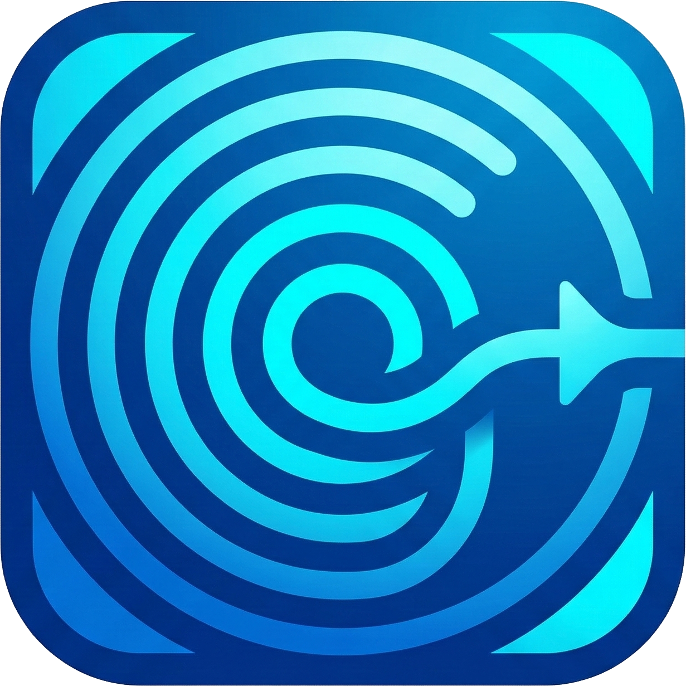

<div align="center">
  

  # 🎙️ WhisperHook

  **System-wide, privacy-focused voice typing powered by local AI.**

  [](https://opensource.org/licenses/MIT)
  
  
  *Dictate anywhere. Instant transcription. Total privacy.*

</div>


***

Welcome to **WhisperHook**! WhisperHook is a blazing-fast, cross-platform dictation tool that uses local machine learning models directly on your device. Just press a hotkey from **any** application on your computer, speak, and watch your words magically appear on screen. 🚀

## ✨ Why WhisperHook?
- **🔐 100% Local & Private:** Your voice never leaves your computer. Powered by `faster-whisper`, everything processes offline. 
- **⚡ System-Wide Integration:** Works with your browser, Word, IDEs, or any other application.
- **🎤 Zero-Friction Dictation:** 
  - **Push-to-Talk:** Hold `Ctrl+Shift+M` to transcribe.
  - **Real-Time:** Seamless natural speaking, powered by Voice Activity Detection (VAD).
- **🎨 Unobtrusive Design:** Lives quietly in your system tray with a floating indicator.
- **⚙️ Customizable:** Choose your Whisper model (tiny to medium), hardware (CPU/CUDA), and language.

***

## 🧠 The AI Engine

WhisperHook relies on two state-of-the-art AI models:
1. **`faster-whisper`**: A deeply optimized reimplementation of OpenAI's Whisper, running up to 4x faster with less memory.
2. **`silero-vad`**: Enterprise-grade Voice Activity Detection to precisely detect human speech and ignore background noise.

---

## 🔒 Privacy & Offline Execution

- **Zero cloud dependency**: All transcription happens locally.
- **No data collection**: No audio or transcription data is ever transmitted.
- **No internet required**: Works completely offline after installation.

---

## 🛠️ Local Development Setup

### Prerequisites
1. **Node.js** (v18+)
2. **Rust & Cargo** (`rustup`)
3. **Python** (3.10+)

### 1. Python Environment Setup
The application uses a Python sidecar for transcription. Prepare the virtual environment:

```bash
cd python-core
python -m venv venv

# Windows
.\venv\Scripts\activate
# Linux/macOS
source venv/bin/activate

pip install -r requirements.txt
```

### 2. Install Frontend Dependencies
```bash
# In the project root
npm install
```

### 3. Run Development Mode
```bash
npm run tauri dev
```

***

## 📦 Generating the Installer

To build a production-ready installer, you must bundle both the frontend and the Python sidecar.

### 1. Build the Frontend
```bash
npm run build
```

### 2. Freeze the Python Sidecar
WhisperHook expects the Python engine as a standalone executable. Use PyInstaller to build it:

```bash
cd python-core
# Ensure your venv is active and requirements are installed
pyinstaller whisper-engine.spec
```
This generates the executable in `python-core/dist/whisper-engine`.

### 3. Build the Tauri Application
Finally, build the installer (NSIS on Windows):

```bash
npm run tauri build
```
The final installer will be located in `src-tauri/target/release/bundle/`.

---

## 📄 License
This project is licensed under the **MIT License**. See the [LICENSE](LICENSE) file for details.
